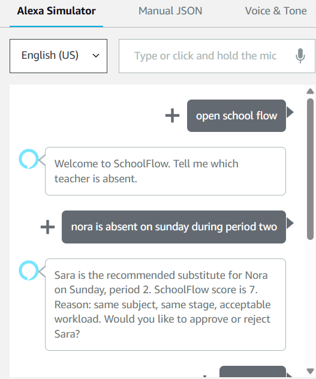
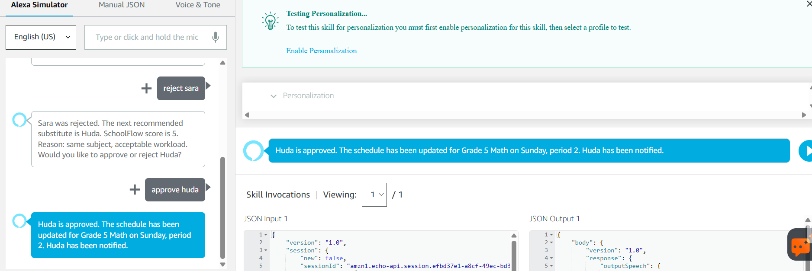

## End-to-End Alexa Demo

SchoolFlow was tested successfully as a complete voice-driven workflow through the Alexa Simulator.

### 1. Initial recommendation

Nora is reported absent on Sunday during period 2.  
SchoolFlow evaluates the available candidates and recommends Sara based on subject match, school stage, and workload.

### 2. Human rejection, re-ranking, and approval

The administrator rejects Sara.  
SchoolFlow remembers the rejection, re-ranks the remaining candidates, recommends Huda, and waits for human approval.

After Huda is approved, the schedule is updated and the notification step is completed.

### Verified workflow

**Alexa → AWS Lambda → SchoolFlow Agent → Candidate Validation → Human Approval → Schedule Update → Notification**

**AI recommends → Human approves → System executes safely.**
